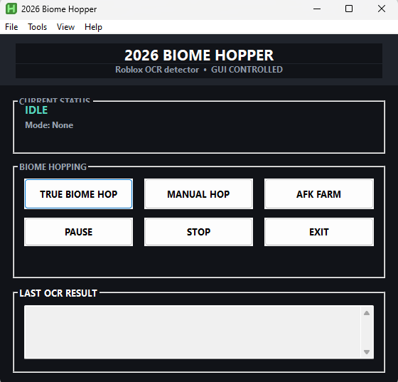

# CRCW Biome Hopper

OCR-based biome hopper for **Classic Retro Craftwars**. Reads the Roblox
chat, pings you on Discord when a rare biome or boss appears, and hops
to the next server automatically until something good shows up.

Works across one account or many. Designed for multi-boxing — run it on
your main PC and on RDPs at the same time (will explain more in video tutorial, will add here later).

---

## Quick Start

1. Install [AutoHotkey v2](https://www.autohotkey.com/v2/)
2. Download the [latest release](https://github.com/Jaisuhn/ChoerryProBiomeHopper/releases/latest)
3. **Extract** the zip to a folder — do not run from inside the zip
4. Double-click `ChoerryProBiomeHopper.ahk`
5. Open **Tools → Discord Notifications** and paste your webhook + private server link
6. Open **Tools → Capture Join Window**, **Capture Join Click**, **Capture Play Button** and follow the on-screen prompts (one-time setup per account)
7. Press **F9** to start hopping

Multiple RDPs: Included in the zip is `rdp_manager.ahk`. Run this on your host PC to automatically tile and organize your RDP windows. Press Ctrl+Alt+M to select the monitor, and F2 to tile them.

**Full setup walkthrough →** [docs/first-run.md](docs/first-run.md)
**Video tutorial →** *(coming soon)*
**Latest release →** [github.com/Jaisuhn/ChoerryProBiomeHopper/releases/latest](https://github.com/Jaisuhn/ChoerryProBiomeHopper/releases/latest)

---

## What it does

- **Biome detection** — reads the game's biome announcements by hovering
  the mouse over chat. Uses OCR.
- **Boss detection** — watches for specific boss spawn lines and boss health bars
- **Discord notifications** — pings a role or user with the biome, boss, and your private server link
- **Auto-hop** — rejoins your private server when a bad biome appears, until a good one shows up
- **Camp-on-good** — stays put and pings you when a rare biome appears, resets when the biome returns to normal
- **Auto-attack** — optional attack sequence that runs while camping a biome. Sequences live in `attack_sequences.txt` and are editable via **Tools → Edit Attack Sequences**. ⚠️ *Work in progress — test on an alt before relying on it.*
- **Watchdog** — pings you on Discord if the script gets stuck and needs a manual check

## Required / Optional

- **Windows 10 or 11**
- **AutoHotkey v2.0 or newer** — [download](https://www.autohotkey.com/v2/)
- **Roblox Account Manager** — OR any browser you use to open the private server link (Chrome, Firefox, etc.)
- **Discord webhook** — for notifications (optional but recommended, this is what I personally use so I know ASAP and I can ping people)

## Hotkeys (technically is changeable via code but not via GUI if I remember right)

| Key | Action |
|---|---|
| **F6** | Pause / Resume |
| **F7** | Stop hopping |
| **F8** | Exit the script |
| **F9** | Start biome hopping |
| **F10** | Manual hop (single rejoin, no scanning) |
| **Ctrl+Alt+R** | Force Resume (unstuck) |
| **Ctrl+Alt+T** | Debug: show OCR scan results |
| **Ctrl+Shift+A** | Toggle auto-attack manually |
| **Ctrl+Shift+1..4** | Manual hop for multi-RDP setups |
| **Ctrl+Alt+Z** | Stage the last boss for the CRCW Discord |
| **Ctrl+Alt+W** | Stage the last biome for the CRCW Discord |

Every setting (webhook URLs, private server link, chat display name, biome
and ore choices, captured coordinates) is saved automatically to
`biome_hopper_config.ini` in the same folder as the script. That file is
per-account — do not copy it between accounts.

## Troubleshooting

See [docs/troubleshooting.md](docs/troubleshooting.md) for common
problems and fixes. If you're stuck, the most common causes are:

1. Private server code expired — regenerate it and paste the new link
2. Play button not captured on that specific RDP — recapture with
   **Tools → Capture Play Button**
3. Chat region not calibrated — run **Tools → Calibrate OCR Region**

## Credits & Attribution

This project was directed and tested by **J_ai (main acc) / YoungCreeperTru (Choerry) / Pro (projarehehe123) / my other alts**.

The AHK code was written in collaboration with **Claude (Anthropic)** and **DeepSeek**, AI assistants — the author provided feature direction, requirements, test feedback, and design decisions; the AI produced the majority of the code. Attribution is included here in the interest of honesty.

### Libraries and prior work

- **OCR library:** [Descolada/OCR](https://github.com/Descolada/OCR) — required dependency
- **FindText reference:** [FeiYue's FindText](https://www.autohotkey.com/boards/viewtopic.php?f=6&t=17834)
  (referenced for pattern ideas)
- **Community inspiration:** MrToaster's biome hopping script — really helped me fix my approach to certain functions. Gotta show love to a fellow biome hopper!
- **Built for:** the Classic Retro Craftwars community and possibly other CW games :D

## Disclaimer

This tool automates Roblox gameplay. **Use at your own risk.** The
author is not responsible for any account actions, bans, or losses.
Roblox's Terms of Service prohibit automation in some cases — use
responsibly and only on accounts you're willing to risk.

## License

MIT — see [LICENSE](LICENSE).
